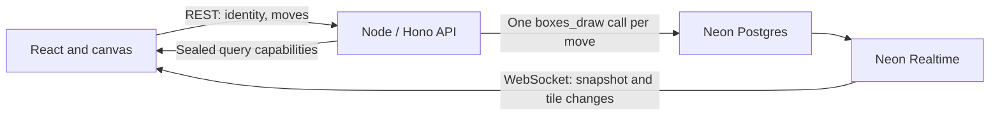

# 1 Million Boxes

A multiplayer game of [Dots & Boxes](https://en.wikipedia.org/wiki/Dots_and_boxes)
on a shared board of one million boxes. Four teams compete to claim boxes by
drawing their final edge, with every move appearing live for everyone playing.

**[Play the demo](https://one-million-boxes.vercel.app/)**

The game is built with [Neon Realtime](https://neon.com/docs/realtime/overview),
a live SQL query engine for Neon Postgres. Clients subscribe to a query, receive
its initial results, then receive changes as the underlying data changes. Here,
that means loading the board and keeping every player's view in sync through the
same subscription.

[Read the Neon Realtime docs](https://neon.com/docs/realtime/overview)

## How it uses Neon

- **Neon Realtime** streams the board directly to browsers over WebSockets.
  Players subscribe to the same parameterized query, so query evaluation is
  shared and the Realtime proxy fans out updates to connected players.
- **[Neon Postgres](https://neon.com/docs/introduction)** stores the board,
  player move allowances and scores. A Postgres function validates and applies
  each move atomically. The API connects through Neon's pooled endpoint;
  schema setup uses a direct connection.
- **The Neon CLI and `neon.ts`** configure Realtime, allowed browser origins and
  connection credentials for your Neon project. The configuration also gives
  newly created non-default branches a seven-day lifetime.

The live demo runs its React frontend and Node.js API on Vercel, with Postgres
and Realtime hosted on Neon.

## How it's built



### A tiled board

The 1,000 × 1,000 board is stored in 15,625 rows, each holding an 8 × 8 tile.
Edge and box owners use three bits each, packed into `bytea` columns. Drawing
an edge updates the affected tiles, keeping both the initial snapshot and live
updates compact. The Realtime SDK decodes the binary fields into typed arrays
for the canvas renderer.

### Moves in Postgres

Each draw makes one database call to `boxes_draw`. The function locks the
player's move allowance and the tiles needed to check adjacent boxes, validates
the move, and updates the board and counters in one transaction. Tiles are locked
in a consistent order, allowing unrelated parts of the board to progress
concurrently. The API holds no in-memory game state.

Players receive a random team and a signed identity cookie. They start with
eight moves, regain one every three seconds, and earn bonus moves by completing
boxes. Postgres enforces these rules for every draw.

### Live subscriptions

The API uses `@neon/realtime/server` to issue short-lived, sealed capabilities
for fixed board and game queries. The browser uses `@neon/realtime/client` to
subscribe directly to Realtime; the signing secret stays on the server.

The board subscription delivers the initial tiles and subsequent committed
changes. A second subscription watches the game's start timestamp so clients
can detect a reset. The client renews capabilities, reconnects when needed and
uses transaction IDs returned by the draw API to confirm that a move has arrived
through Realtime.

The implementation lives in [`src/`](src/) (React and canvas),
[`server/`](server/) (HTTP API and SQL), and [`shared/`](shared/) (game rules and
tile encoding). See [SPEC.md](SPEC.md) for the full game and architecture details.

## Run locally

You need Node.js 22.22.2+ (or 24.15+ / 26+), pnpm, and a Neon project with
Realtime enabled. Use a dedicated database for the game, with a role that can
create tables and functions and read and write the game data.

Install dependencies, sign in and link your Neon project:

```sh
pnpm install --frozen-lockfile
pnpm exec neon login
pnpm exec neon link --project-id YOUR_PROJECT_ID --branch YOUR_BRANCH -y
```

The included [`neon.ts`](neon.ts) enables Realtime and allows the local browser
origins `http://127.0.0.1:5173` and `http://localhost:5173`. Review and apply the
configuration, then retrieve the connection details:

```sh
pnpm exec neon config plan
pnpm exec neon deploy
pnpm exec neon env pull --file .env.local
```

Add `TEAM_COOKIE_SECRET` to `.env.local` using a random value generated with:

```sh
node -e "console.log(require('node:crypto').randomBytes(32).toString('hex'))"
```

The environment variables are listed in [`.env.example`](.env.example):

| Variable                | Purpose                                           |
| ----------------------- | ------------------------------------------------- |
| `DATABASE_URL`          | Pooled Postgres connection for API requests       |
| `DATABASE_URL_UNPOOLED` | Direct Postgres connection for schema setup       |
| `NEON_REALTIME_URL`     | Realtime WebSocket endpoint for the same database |
| `NEON_REALTIME_SECRET`  | Server-side secret for sealing query capabilities |
| `TEAM_COOKIE_SECRET`    | Secret for signing player identity cookies        |
| `API_PORT`              | Local API port; defaults to `3001`                |

Keep these credentials server-side. Do not prefix secrets with `VITE_`, which
would expose them in the browser bundle.

Initialize the database and start the app:

```sh
pnpm db:init
pnpm dev
```

Open [http://127.0.0.1:5173](http://127.0.0.1:5173). The frontend and API run
locally, connected to Postgres and Realtime in your Neon project. Open another
browser window to see moves appear live across both players.

`pnpm db:init` installs the schema, draw function and missing board tiles while
preserving existing play. Run it again when updating the schema or draw function;
database setup does not run at API startup. To clear the board, scores and player
move allowances in your configured database, run `pnpm db:reset`.

## Deploy to Vercel

After configuring Neon and initializing the database:

1. Run `vercel link` and set `DATABASE_URL`, `NEON_REALTIME_URL`,
   `NEON_REALTIME_SECRET` and `TEAM_COOKIE_SECRET` in the Vercel project's
   environment. Use the pooled database URL and keep the cookie secret stable
   across deployments so player identities remain valid.
2. Set your deployed app's origin in `neon.ts` and apply it with
   `pnpm exec neon deploy`.
3. Run `vercel --prod`. The included `vercel.json` builds the frontend and routes
   `/api/*` to the Node.js function.

The API reuses a small Postgres connection pool managed by Vercel Fluid compute.
Its region is set to `iad1` in `vercel.json`; choose a region close to your Neon
project. Preview deployments also need environment variables and allowed
Realtime origins.

## License

Apache-2.0, copyright Databricks, Inc. See [LICENSE](LICENSE).
